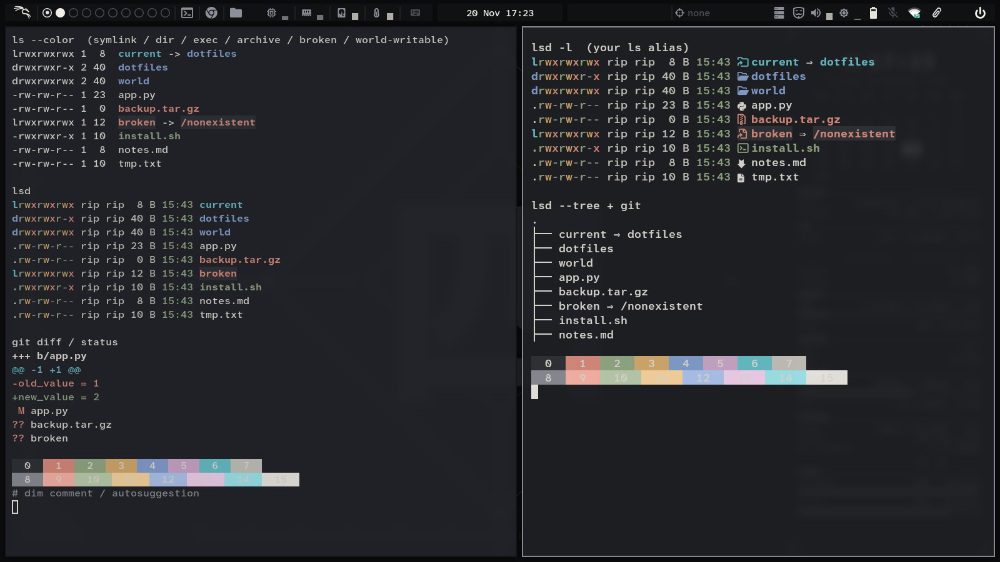
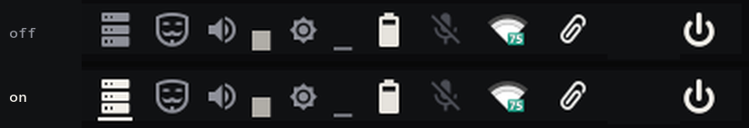
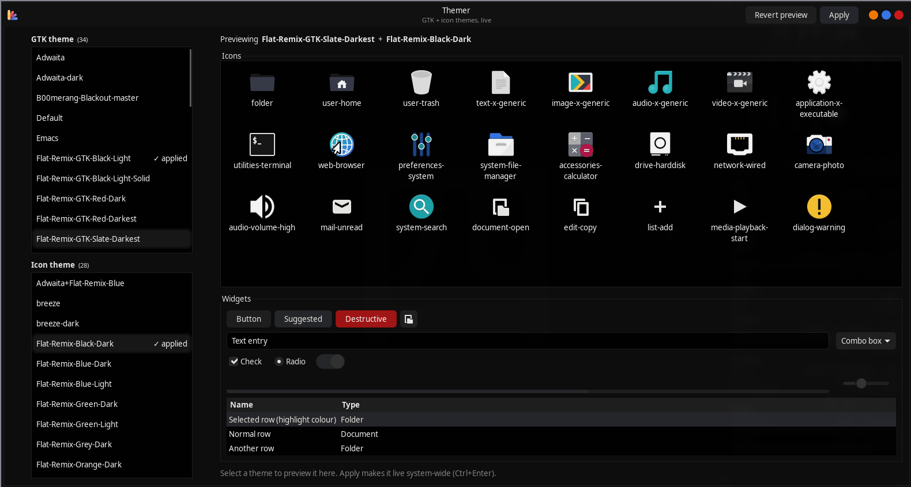

# bspwn

A bspwm desktop for a ThinkPad T450 running Kali/Debian, with a muted monochrome look
colours that stay distinguishable on an old TN panel, and a handful of small custom tools (live theme switcher, keyboard backlight,
"server mode" for closing the lid without suspending). Everything is plain config files and small Python/bash scripts.



## What is in here

- **Two modes, switched live** (`super+ctrl+u`): *cockpit* (default, monochrome, polybar, conky HUD, tiling) and *undercover* (a Windows 10 look, tint2, floating windows).
- **Terminal palette** (kitty + alacritty) with a contrast checker. See [Terminal colours](#terminal-colours).
- **Themer**: a small GTK app that previews GTK and icon themes and applies them live, no relogin. See [Themes](#themes).
- **Keyboard backlight that follows your typing** and **server mode** (keep running with the lid closed). See [Power tools](#power-tools).
- Dotfiles for bspwm, sxhkd, polybar, picom, conky, dunst, rofi, tmux, zsh, nvim, kitty, alacritty and more, with an installer.

## Install

```sh
git clone https://github.com/rippsec/bspwn && cd bspwn
./install.sh --help       # all options; read it first on a machine you care about
./install.sh -config      # only link the configs (also the way to update)
./install.sh -themes      # GTK theme + icons + Qt setup
./install.sh -full        # everything, see below
```

`-full` installs the packages and fonts, links the configs, sets up themes and Neovim, installs the system files (ACPI lid handler, X11 and a bspwm session entry)
and finally **installs XFCE + LightDM and enables LightDM as your login manager** (reboot, then pick the *bspwm* session). Use the smaller options if you do not want that.

The installer copies the project to `~/.bspwn` and symlinks `~/.config/<app>` to `~/.bspwn/dot/.config/<app>`, so editing either path edits the same file.

## Everyday keys (sxhkd)

| Keys | Action |
| --- | --- |
| `super+Return` / `super+shift+Return` | terminal (attached to tmux) / plain terminal |
| `super+d` / `super+r` | app menu (jgmenu) / launcher (rofi) |
| `super+Tab`, `alt+Tab` | window overview / switcher (skippy-xd) |
| `super+ctrl+u` | toggle cockpit / undercover mode |
| `super+ctrl+s` | **toggle server mode** |
| `super+x` | lock the screen |
| `super+Left/Right`, `super+alt+Left/Right` | previous/next desktop, move window there |
| `super+p` | toggle focus-follows-pointer |
| `super+e` | toggle touchpad |
| `Print`, `super+shift+s` | screenshot (flameshot) |
| `super+Escape`, `alt+shift+Escape` | restart bspwm, reload sxhkd |

## Power tools

All settings live in **`~/.config/bspwm/power.conf`** (a symlink to `dot/.config/bspwm/power.conf`). It is plain `KEY=VALUE`, read live: save the file and the change applies
within a few seconds, no restart. The scripts are in `dot/.config/bspwm/scripts/` (`kbd-backlight.py`, `servermode.py`, shared `powerlib.py`) and start from `bspwm/start`.
No root is needed: the keyboard LED is set through logind and the lid is handled with a logind inhibitor lock.

### Keyboard backlight

Any **keypress** lights the keyboard backlight at the minimal level, and it turns off a few seconds after the **last keypress**. Typing keeps it on.
It stays off while the lid is closed. If you change the level yourself (e.g. Fn+Space) it respects that until the timeout, then turns off.
Keys are read from XInput raw events (keyboard only, instant, also seen while the lock screen is up). It works with any `/sys/class/leds/*kbd_backlight*`
(ThinkPad `tpacpi::kbd_backlight`, Dell `dell::kbd_backlight`, ...) and does nothing on a laptop without one.

| Setting | Shipped | Meaning |
| --- | --- | --- |
| `KBD_AUTO` | `1` | `0` = never touch the keyboard backlight |
| `KBD_IDLE_AC` | `1` | seconds after the last keypress before it turns off, on AC. Put `5` or `10` for a longer glow, `0` = never turn off |
| `KBD_IDLE_BAT` | `1` | the same, on battery |
| `KBD_LEVEL` | `1` | level a keypress lights it to (`1` = minimal; `0` = the level it had before) |
| `KBD_WAKE_POINTER` | `0` | `1` = touchpad/mouse input also lights it |

### Server mode (lid closed, laptop keeps running)

For leaving a laptop on a desk running things you reach remotely (ssh, a remote shell, file transfers, remote-controlled sessions): **closing the lid does not suspend**.
The screen locks and goes dark and the keyboard light turns off, but the system and its connections keep running.



- **Turn it on/off**: click the server icon in polybar (next to the mode switcher), press `super+ctrl+s`, or run `~/.config/bspwm/scripts/servermode.py on|off|toggle|status`.
- **On AC** it runs until you turn it off. **On battery** it keeps running until the total charge drops below a threshold, then it turns itself off and the laptop behaves normally
  (it suspends if the lid is closed). The charge is summed over all batteries.
- It is **off after every reboot/logout** on purpose (state lives in `$XDG_RUNTIME_DIR`).
- **Safe by design**: the lid is ignored only while the daemon holds an inhibitor lock, which the kernel releases the moment the daemon exits or crashes.

| Setting | Shipped | Meaning |
| --- | --- | --- |
| `SERVER_BATTERY_MIN` | `auto` | battery % below which server mode ends. `auto` = 20 on laptops with two batteries (ThinkPad with the slice), 55 on single-battery laptops; or a number, e.g. `60` |
| `SERVER_TEMP_MAX` | *(commented out)* | uncomment (e.g. `88`) to also end server mode, and suspend, above a temperature in °C. Off by default |
| `SERVER_LOCK` | `1` | lock the screen when the lid closes (the ACPI lid handler usually does it first; this is the fallback) |
| `SERVER_SCREEN_OFF` | `1` | turn the display off while the lid is closed |

Troubleshooting: `servermode.py status`, `systemd-inhibit --list | grep bspwn` (the lock is held while it is on), `journalctl -t bspwn-power` (daemon log).
Wi-Fi power saving should be off for remote access to stay snappy (`iw dev wlan0 get power_save`).
The logic is covered by tests on a fake sysfs: `python3 scripts/tests/test_power.py`.

## Themes

`themer` (installed to `~/.local/bin/themer`, also in the app menu) shows your installed GTK and icon themes, restyles its own window and a sample icon grid as you click, and **Apply** (`Ctrl+Enter`)
makes the choice live: xsettingsd and gsettings (running apps), GTK 2/3/4 settings, Qt (qt5ct/qt6ct icons), rofi, and the active mode profile so a mode switch or `bspc wm -r` keeps it.



```sh
themer                                   # GUI
themer --gtk Adwaita-dark --icons Papirus   # headless
themer --list      # installed themes        themer --current   # what is live
```

The default theme here is `Flat-Remix-GTK-Slate-Darkest`, a custom variant generated with the upstream
[flat-remix-gtk](https://github.com/daniruiz/flat-remix-gtk) script and bundled in `dot/theme/themes` (icons: Flat-Remix-Black-Dark in `dot/theme/icons`).
To make your own: `./generate-color-theme.sh Name '#HIGHLIGHT' '#HIGHLIGHT_TEXT'` (needs `make inkscape sassc optipng`), then copy the result to `dot/theme/themes/` and `~/.themes/`.
Modes keep their theme names in `dot/.config/bspwm/modes/*.conf`.

## Terminal colours

`dot/.config/kitty/cockpit.conf` and the `[colors]` block of `dot/.config/alacritty/alacritty.toml` hold the same palette (alacritty reloads by itself; kitty: `ctrl+shift+f5`).
Lifted background, soft off-white text, no deep blue; every colour differs by **lightness as well as hue**
so that, for example, a symlink (cyan) and a directory (blue) are never confused.

```sh
python3 scripts/palette_check.py         # contrast + colour-difference report; exit 1 if a target is missed
```

It checks text contrast, that every pair of hues is far enough apart (CIEDE2000 ≥ 20, ≥ 14 with the colours washed out to 60%) and that bright variants differ from normal ones.
Edit both files together, re-run the checker, and look at it in a real terminal. `lsd` (the `ls` alias) is mapped onto the palette in `dot/.config/lsd/`.

## Other pieces

- **Wallpapers**: generated with Pillow by `scripts/wallpaper/gen_*.py` into `assets/wallpaper/`; the active one is set in `modes/cockpit.conf` and `bspwm/start`.
- **jarvis/**: an optional voice assistant driven by Claude Code (see `jarvis/README.md`, in Spanish). Not installed unless you set it up.
- **system/**: root-level files (ACPI lid handler, X11, tlp, display manager) installed by `./install.sh -system`.

## Repo layout

```
dot/.config/<app>/      app configs (symlinked into ~/.config)      dot/theme/     bundled GTK theme + icons
dot/.config/bspwm/      bspwmrc, start (autostart), modes/, power.conf, scripts/ (mode.sh, power tools, ...)
scripts/                themer/, palette_check.py, wallpaper/, tests/
install.sh, install/    installer (packages, fonts, themes, configs, ...)       system/   root-level files
```

## Working on it with Claude Code

The author keeps a private [Claude Code](https://claude.com/claude-code) skill that describes this setup (layout, how modes/themes/power tools fit together, gotchas), so an assistant can make changes
without re-reading the whole repo. The same idea works for any dotfiles repo: a short `SKILL.md` map plus a few reference files, updated whenever the setup changes.

## License

GPL-2.0, see [LICENSE](LICENSE).
