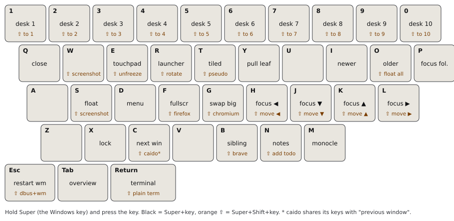

# bspwn cheatsheet

*Super = the Windows key. A capital letter in sxhkdrc means Shift. tmux prefix is `Ctrl+b`; the Alt keys need no prefix.*

## Desktop: Apps and menus

| Keys | Action |
| --- | --- |
| `Super+Return` | Terminal attached to the tmux session |
| `Super+shift+Return` | Plain terminal, no tmux |
| `Super+d` | App menu |
| `Super+r` | Full-screen launcher |
| `Super+shift+g` | Chromium |
| `Super+shift+f` | Firefox |
| `Super+shift+b` | Brave browser |
| `Super+shift+c` | Caido |
| `Super+n` | Desktop notes: edit |
| `Super+shift+n` | Desktop notes: quick-add a todo |
| `Super+ctrl+n` | Desktop notes: tick a task |
| `Super+Tab` | Window overview |
| `alt+Tab` | Window switcher: hold Alt, Tab cycles, release to focus |
| `alt+shift+Tab` | Window switcher, backwards |

## Desktop: Desktop, power and system

| Keys | Action |
| --- | --- |
| `Super+x` | Lock the screen |
| `Super+ctrl+u` | Switch mode live: cockpit <-> undercover |
| `Super+ctrl+e` | Spreadsheet key: undercover mode, minimise all windows, OnlyOffice sheet on top |
| `Super+ctrl+s` | Server mode on/off |
| `Super+Escape` | Restart bspwm |
| `alt+shift+Escape` | Reload sxhkd |
| `Super+alt+Escape` | Log out |
| `Super+shift+Escape` | Restart the D-Bus daemon and bspwm |
| `Super+p` | Toggle focus-follows-pointer |
| `Super+e` | Toggle touchpad |
| `Super+shift+e` | Un-freeze a stuck touchpad |
| `Print` | Screenshot, region |
| `Super+shift+s` | Screenshot, region |
| `ctrl+Print` | Screenshot, region copied to the clipboard |
| `Super+shift+w` | Screenshot, whole screen saved to ~/Pictures |
| `XF86AudioRaiseVolume` | Volume up |
| `XF86AudioLowerVolume` | Volume down |
| `XF86AudioMute` | Mute |
| `XF86AudioMicMute` | Microphone mute |
| `XF86MonBrightnessUp` | Brightness +3% |
| `XF86MonBrightnessDown` | Brightness -3% |

## Desktop: Windows (bspwm)

| Keys | Action |
| --- | --- |
| `Super+q` | Close the focused window |
| `Super+m` | Toggle tiled / monocle layout |
| `Super+t` | Tiled |
| `Super+shift+t` | Pseudo-tiled |
| `Super+f` | Fullscreen |
| `Super+s` | Floating |
| `Super+shift+o` | Float / un-float all windows |
| `Super+ctrl+x` | Lock the window against closing |
| `Super+ctrl+y` | Sticky |
| `Super+ctrl+z` | Private |
| `Super+g` | Swap with the biggest window |
| `Super+y` | Send to the last manual window / pull the last leaf |
| `Super+shift+r` | Rotate the whole layout 90 degrees |
| `Super+h` | Focus window to the left |
| `Super+j` | Focus window below |
| `Super+k` | Focus window above |
| `Super+l` | Focus window to the right |
| `Super+shift+h` | Move window left |
| `Super+shift+j` | Move window down |
| `Super+shift+k` | Move window up |
| `Super+shift+l` | Move window right |
| `Super+b` | Focus the sibling |
| `Super+comma` | Focus the first child |
| `Super+period` | Focus the second child |
| `Super+c` | Focus next window on this desktop |
| `Super+o` | Focus the older window in the focus history |
| `Super+i` | Focus the newer window in the focus history |

## Desktop: Desktops

| Keys | Action |
| --- | --- |
| `Super+1..9,0` | Go to desktop 1-9 and 10 |
| `Super+shift+1..9,0` | Send the window there and follow it |
| `Super+Left` | Previous desktop |
| `Super+Right` | Next desktop |
| `Super+alt+Left` | Send window to the previous desktop |
| `Super+alt+Right` | Send window to the next desktop |
| `Super+bracketleft` | Previous desktop |
| `Super+bracketright` | Next desktop |

## Desktop: Resize, preselect, mouse

| Keys | Action |
| --- | --- |
| `Super+alt+h` | Grow the window to the left |
| `Super+alt+j` | Grow it downwards |
| `Super+alt+k` | Grow it upwards |
| `Super+alt+l` | Grow it to the right |
| `Super+alt+shift+h` | Shrink from the right |
| `Super+alt+shift+j` | Shrink from the top |
| `Super+alt+shift+k` | Shrink from the bottom |
| `Super+alt+shift+l` | Shrink from the left |
| `Super+shift+Left` | Move a floating window left |
| `Super+shift+Down` | Move a floating window down |
| `Super+shift+Up` | Move a floating window up |
| `Super+shift+Right` | Move a floating window right |
| `Super+ctrl+h` | Preselect: next window opens to the left |
| `Super+ctrl+j` | Preselect: below |
| `Super+ctrl+k` | Preselect: above |
| `Super+ctrl+l` | Preselect: to the right |
| `Super+ctrl+1..9` | Preselect the split ratio 0.1 .. 0.9 |
| `Super+ctrl+space` | Cancel the preselection of this window |
| `Super+ctrl+shift+space` | Cancel all preselections on this desktop |
| `Super+left-drag` | Move a window with the mouse |
| `Super+right-drag` | Resize a window by the nearest corner |

## tmux: Without the prefix (Alt)

| Keys | Action |
| --- | --- |
| `Alt+t` | New window |
| `Alt+1..9` | Go to window 1-9 |
| `Alt+Left` | Previous window |
| `Alt+Right` | Next window |
| `Alt+{` | Move the window left in the list |
| `Alt+}` | Move the window right in the list |
| `Alt+e` | Rename the window |
| `Alt+q` | Kill the window |
| `Alt+|` | Split side by side |
| `Alt+-` | Split top / bottom |
| `Alt+h` | Pane left |
| `Alt+j` | Pane down |
| `Alt+k` | Pane up |
| `Alt+l` | Pane right |
| `Alt+shift+h` | Resize pane left |
| `Alt+shift+j` | Resize pane down |
| `Alt+shift+k` | Resize pane up |
| `Alt+shift+l` | Resize pane right |
| `Alt+,` | Swap pane up |
| `Alt+.` | Swap pane down |
| `Alt+z` | Zoom / unzoom the pane |
| `Alt+o` | Zoom / unzoom the pane |
| `Alt+x` | Kill the pane |
| `Alt+w` | Kill the pane |
| `Alt+shift+w` | Kill the pane, no question |
| `Alt+space` | Next pane layout |
| `Alt+v` | Scroll / copy mode |
| `Alt+m` | Mouse mode on/off |
| `Alt+r` | Reload ~/.tmux.conf |

## tmux: After the prefix (Ctrl+b, then the key)

| Keys | Action |
| --- | --- |
| `Ctrl+b t` | New window |
| `Ctrl+b w` | Pick a window from a tree |
| `Ctrl+b s` | Pick a session from a tree |
| `Ctrl+b S` | New session |
| `Ctrl+b d` | Detach |
| `Ctrl+b |` | Split side by side |
| `Ctrl+b -` | Split top / bottom |
| `Ctrl+b b` | Break the pane out into its own window |
| `Ctrl+b Escape` | Scroll / copy mode |
| `Ctrl+b p` | Paste buffer |
| `Ctrl+b P` | Choose a paste buffer |
| `Ctrl+b r` | Reload ~/.tmux.conf |
| `Ctrl+b T` | Clock |
| `Ctrl+b Ctrl+l` | Clear screen and history |
| `Ctrl+b Ctrl+s` | Show / hide the status bar |
| `Ctrl+b Ctrl+b` | Send Ctrl+b to the program inside |

## tmux: Scroll / copy mode (vim keys)

| Keys | Action |
| --- | --- |
| `v` | Start selecting |
| `y` | Copy to the clipboard |
| `Y` | Copy and leave |
| `r` | Rectangle selection |
| `/` | Search forward |
| `?` | Search backward |
| `b / w / e` | Word back / forward / end |
| `q` | Leave copy mode |

## zsh

| Keys | Action |
| --- | --- |
| `Ctrl+F` | Fuzzy-find any file and paste its path |
| `Tab / Shift+Tab` | Cycle the completion menu forward / back |
| `Left / Right` | Move the text cursor |
| `Ctrl+Left / Right` | Jump a word |
| `Ctrl+Delete` | Delete the next word |
| `PageUp / PageDown` | Start / end of history |

## Polybar (mouse)

| Keys | Action |
| --- | --- |
| `1 Kali logo` | App launcher: click: full-screen launcher; click again to close |
| `2 Ten dots` | Desktops 1-9, 0: click a dot to go there |
| `3 Terminal` | Terminal: left: terminal + tmux session; right: plain terminal |
| `4 Globe` | Browser (Brave): left: open Brave |
| `5 Folder` | File manager (Thunar): left: home; right: Downloads |
| `11 Date and time` | Clock: click: calendar dropdown |
| `12 Link icon` | LHOST: your address for lab work: left: pick an interface or type an IP; right/double click: copy |
| `13 Crosshair` | RHOST: the target address: left: set/edit; right/double click: copy |
| `- 󰳓 / bell / 󱁣` | Claude Code status, shown only while a session is active (not in the picture): click: clear finished sessions |
| `14 Server rack` | Server mode (lid closed = keep running): click: toggle |
| `15 Mask` | Mode switch cockpit <-> undercover: click: switch |
| `16 Speaker` | Volume: scroll: volume; red speaker = muted |
| `17 Sun / gear` | Brightness: scroll: brightness |
| `18 Battery` | All batteries combined: click: details notification |
| `19 Microphone` | Mic mute: click: mute/unmute (red lit = live) |
| `20 Tray` | Network applet, clipboard manager, app icons: per app |
| `21 Power symbol` | Power menu: click: Lock, Sleep, Hibernate, Logout, Restart, Shutdown |

Generated by `scripts/docs/build.py` from `scripts/docs/keys.py`.

© 2025-2026 rippsec and contributors · GPL-2.0-only code, docs CC BY-SA 4.0 · <https://github.com/rippsec/bspwn>