# BSPWN user manual

*Using it, changing it, making it yours.* Built 2026-11-27 from the repository. This manual has a printable PDF ([BSPWN-manual.pdf](BSPWN-manual.pdf)),
a one-page [cheatsheet](BSPWN-cheatsheet.md) ([PDF](BSPWN-cheatsheet.pdf)) and an [interactive version](interactive.html) you open in a browser to practise the keys.

## Contents

  - [Contents](#contents)
- [1. Start here](#1-start-here)
  - [What this is](#what-this-is)
  - [The five-minute tour](#the-five-minute-tour)
  - [How to read this manual](#how-to-read-this-manual)
- [2. How it fits together](#2-how-it-fits-together)
  - [The big picture](#the-big-picture)
  - [From login to desktop](#from-login-to-desktop)
  - [What happens when you press a key](#what-happens-when-you-press-a-key)
  - [Where the files really are](#where-the-files-really-are)
  - [Vocabulary](#vocabulary)
- [3. Install and update](#3-install-and-update)
- [4. Using the desktop](#4-using-the-desktop)
  - [The bar, symbol by symbol](#the-bar-symbol-by-symbol)
  - [The HUD column](#the-hud-column)
  - [Tiling in five minutes](#tiling-in-five-minutes)
  - [Mouse](#mouse)
  - [Launchers and apps](#launchers-and-apps)
  - [Screenshots](#screenshots)
  - [Power menu](#power-menu)
- [5. Desktop shortcuts](#5-desktop-shortcuts)
  - [Notes on the key list](#notes-on-the-key-list)
- [6. tmux](#6-tmux)
- [7. The shell (zsh)](#7-the-shell-zsh)
- [8. Modes: cockpit and undercover](#8-modes-cockpit-and-undercover)
- [9. Themes, colours and wallpaper](#9-themes-colours-and-wallpaper)
  - [themer](#themer)
  - [Terminal palette](#terminal-palette)
  - [Other colours](#other-colours)
  - [Wallpaper](#wallpaper)
- [10. Lock screen and idle](#10-lock-screen-and-idle)
- [11. Power tools](#11-power-tools)
- [12. Changing things](#12-changing-things)
  - [The safe way to change anything](#the-safe-way-to-change-anything)
  - [Where do I change X, and how do I reload it?](#where-do-i-change-x-and-how-do-i-reload-it)
  - [Recipes](#recipes)
  - [Rules of thumb](#rules-of-thumb)
- [13. Working with Claude Code](#13-working-with-claude-code)
- [14. Troubleshooting](#14-troubleshooting)
- [15. Licence, credits and reuse](#15-licence-credits-and-reuse)
- [Appendix A. File map](#appendix-a-file-map)
- [Appendix B. Rebuilding this documentation](#appendix-b-rebuilding-this-documentation)

# 1. Start here

## What this is

**bspwn** is a complete desktop for Linux built around the tiling window manager **bspwm**. It is a set of plain text config files plus a few small tools,
made for a ThinkPad T450, with a muted monochrome look, no neon and no pure black.

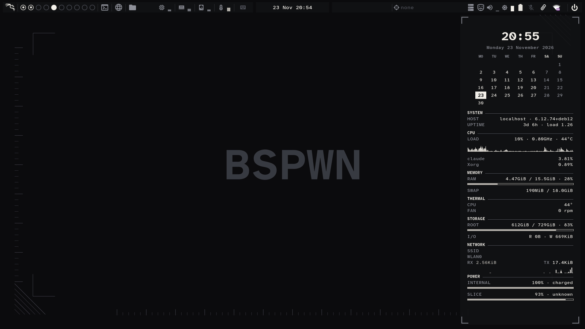

A *tiling* window manager has no overlapping windows that you drag around. It splits the screen into tiles and places every new window in one, so everything is
visible and everything is reachable from the keyboard. If you have never used one, read [Tiling in five minutes](#tiling-in-five-minutes) first.

## The five-minute tour

| You want to... | Do this |
| --- | --- |
| open a terminal | `Super+Return` (it attaches to a tmux session) |
| open a program by name | `Super+r`, type, `Enter` |
| open a browser | click the globe in the bar, or `Super+Shift+b` (Brave) |
| move to another desktop | `Super+1`..`Super+0`, or click a dot in the bar |
| send a window to another desktop | `Super+Shift+1`..`0` |
| close a window | `Super+q` |
| lock the screen | `Super+x` |
| change the look of everything | `Super+Ctrl+u` (cockpit <-> undercover) or run `themer` |
| see every shortcut | the [cheatsheet](BSPWN-cheatsheet.md) |

**Super** is the Windows key. That is the main modifier for the desktop; inside tmux the main modifier is **Alt**.

## How to read this manual

- Chapters 2-4 explain how the pieces fit together and how to use the desktop every day.
- Chapters 5-7 are the key reference for the desktop, tmux and the shell.
- Chapters 8-11 cover the special features: modes, themes, the lock screen and the power tools.
- **Chapter 12 is the one to use when you want to change something**: it lists where everything lives and has a recipe for the common changes.
- Chapter 13 explains how to let Claude Code (an AI coding assistant) change the setup for you, safely.

# 2. How it fits together

## The big picture

Nothing here is one big program. Each job is done by a small, replaceable tool, and they talk to each other through the command line:

| Tool | Job | Config lives in |
| --- | --- | --- |
| **bspwm** | the window manager: decides where windows go (tiles) | `dot/.config/bspwm/bspwmrc` |
| **sxhkd** | listens to the keyboard and runs a command per shortcut | `dot/.config/sxhkd/sxhkdrc` |
| **polybar** | the bar along the top (desktops, apps, sensors, buttons) | `dot/.config/polybar/config.ini` |
| **conky** | the HUD column on the right (clock, CPU, memory, network, batteries) | `dot/.config/conky/hud.conf` |
| **rofi / jgmenu** | the launcher (`Super+r`) and the app menu (`Super+d`) | `dot/.config/rofi/`, `jgmenu/` |
| **dunst** | notifications | `dot/.config/dunst/dunstrc` |
| **alacritty / kitty** | terminals (same colour palette) | `dot/.config/alacritty/`, `kitty/` |
| **tmux** | terminal multiplexer: windows and panes inside one terminal that survive closing it | `dot/.tmux.conf` |
| **zsh** | the shell: prompt, aliases, completion, fzf | `dot/.zsh/` |
| **themer** | a small GUI that restyles GTK and icons live | `scripts/themer/themer.py` |
| **xlock** | the lock screen (a fake blue screen) | `system/bin/xlock*` |
| **power tools** | keyboard backlight, server mode, battery guard | `dot/.config/bspwm/scripts/` + `power.conf` |

## From login to desktop

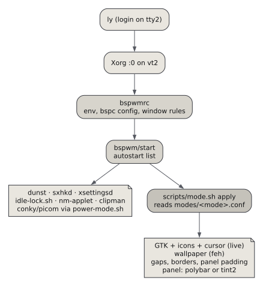

1. **ly** (the login screen on tty2, white on black) starts **Xorg** on virtual terminal 2 and runs the chosen session: *bspwm*, or *bspwn* (the session launcher that also switches to xfwm4 in undercover mode). `ly-watchdog.service` restarts ly if a login hangs after Xorg starts.
2. **`bspwmrc`** runs first: environment variables, the 10 desktops, border colours, gaps, and the *window rules* (which programs float).
3. **`bspwm/start`** runs next: it restarts the helper programs listed in `process_list` (dunst, sxhkd, xsettingsd, nm-applet, ...), starts the power
   daemons and the idle locker, and finally calls `mode.sh apply`.
4. **`mode.sh apply`** reads the active *mode profile* (chapter 8) and sets the theme, wallpaper, gaps and panel. Polybar is started from there.

## What happens when you press a key

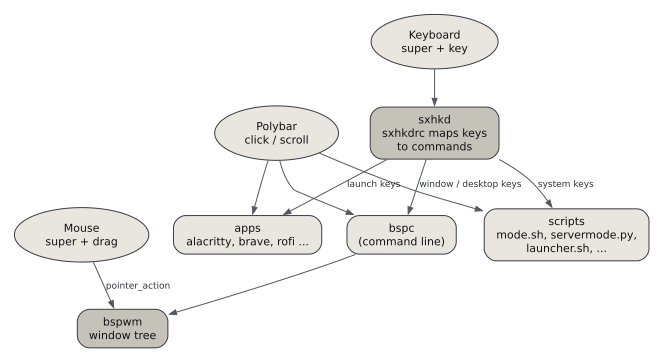

**sxhkd** is the only program that reads your shortcuts. For a window action it calls `bspc` (the command line of bspwm); for a system action it
runs a script from `dot/.config/bspwm/scripts/`; for an app it just starts it. Because everything is a plain command, you can run any shortcut
by hand in a terminal, which is also the easiest way to debug one.

## Where the files really are

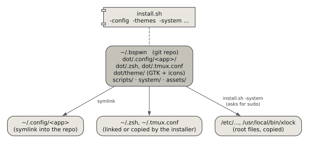

The repository is cloned (or copied by the installer) to **`~/.bspwn`**. Each folder in `~/.config/` is a **symlink** into `~/.bspwn/dot/.config/`,
so editing `~/.config/sxhkd/sxhkdrc` and editing `~/.bspwn/dot/.config/sxhkd/sxhkdrc` are the same thing, and `git` sees the change.
Only a few things live outside: the lock screen script and a PAM file in `/usr/local/bin` and `/etc` (root files, installed by `./install.sh -system`).

## Vocabulary

| Word | Meaning |
| --- | --- |
| **Super** | the Windows key |
| **desktop** | a virtual screen (bspwm has 10: keys `1`..`0`). Not the same as a tmux *window* |
| **node** | a window (or a container of windows) in bspwm's tree |
| **tiled / floating / monocle** | tiled = split the screen; floating = free-moving like Windows; monocle = one window full size, the others hidden behind it |
| **preselect** | tell bspwm in advance where the *next* window should open |
| **mode** | a whole-desktop profile: *cockpit* (monochrome, tiling) or *undercover* (Windows 10 look, floating) |
| **HUD** | the conky column of live stats on the right |
| **island** | one of the floating pills the bar is made of |
| **LHOST / RHOST** | your address and the target's address, for lab work; two small widgets in the bar |
| **prefix** | in tmux, the key you press first (here `Ctrl+b`) before the command key |

# 3. Install and update

```sh
git clone https://github.com/rippsec/bspwn && cd bspwn
./install.sh --help       # read this first on a machine you care about
./install.sh -config      # link the configs only (also the way to update)
./install.sh -themes      # GTK theme + icons + Qt settings
./install.sh -wallpaper   # personal wallpaper: the BSPWN layout with your user name in capitals
./install.sh -full        # everything (packages, fonts, system files, XFCE + LightDM as login manager)
```

`-full` changes your login manager and installs system files. On a machine you care about, use the smaller options one by one.
The installer copies the project to `~/.bspwn` and links the configs. It was written for Debian/Kali with `apt` and tested on one ThinkPad.

> **Using another computer?** Screen size, battery names, network card and keyboard backlight differ. Chapter 13 shows how to have Claude Code adapt the setup for you,
> and `.claude/skills/adapt-bspwn/references/hardware-map.md` is a checklist you can follow by hand.

**Update:** `cd ~/.bspwn && git pull`, then `~/.config/bspwm/scripts/mode.sh apply` and `bspc wm -r`. Back up first if you changed files: `./install.sh -backup`.

# 4. Using the desktop

## The bar, symbol by symbol

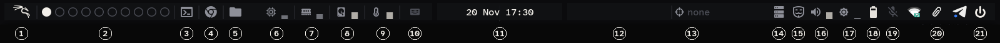

The bar is a set of floating islands. Every symbol is listed here with what a click or scroll does. (The address next to 12 is hidden in the picture on purpose.)

| # | Symbol | What it is | Mouse |
| --- | --- | --- | --- |
| 1 | Kali logo | App launcher | click: full-screen launcher; click again to close |
| 2 | Ten dots | Desktops 1-9, 0 | click a dot to go there |
| 3 | Terminal | Terminal | left: terminal + tmux session; right: plain terminal |
| 4 | Globe | Browser (Brave) | left: open Brave |
| 5 | Folder | File manager (Thunar) | left: home; right: Downloads |
| 6 | Chip | CPU load | display only |
| 7 | Memory | RAM in use | display only |
| 8 | Disk | Root disk fullness | display only |
| 9 | Thermometer | CPU temperature | display only |
| 10 | Keyboard | Modifier keys (shows Super/Ctrl/Alt/Shift while held) | display only |
| 11 | Date and time | Clock | click: calendar dropdown |
| 12 | Link icon | LHOST: your address for lab work | left: pick an interface or type an IP; right/double click: copy |
| 13 | Crosshair | RHOST: the target address | left: set/edit; right/double click: copy |
| - | 󰳓 / bell / 󱁣 | Claude Code status, shown only while a session is active (not in the picture) | click: clear finished sessions |
| 14 | Server rack | Server mode (lid closed = keep running) | click: toggle |
| 15 | Mask | Mode switch cockpit <-> undercover | click: switch |
| 16 | Speaker | Volume | scroll: volume; red speaker = muted |
| 17 | Sun / gear | Brightness | scroll: brightness |
| 18 | Battery | All batteries combined | click: details notification |
| 19 | Microphone | Mic mute | click: mute/unmute (red lit = live) |
| 20 | Tray | Network applet, clipboard manager, app icons | per app |
| 21 | Power symbol | Power menu | click: Lock, Sleep, Hibernate, Logout, Restart, Shutdown |

The **power button (21)** has an island of its own, so a crowded tray can never push it off the screen. The **launcher button (1)** has a matching island on the far left. Both are flush with the neighbouring island and joined by a thin separator, so the bar looks continuous.

## The HUD column

A *conky* widget on the right: a clock and calendar, then blocks for **SYSTEM**, **CPU**, **MEMORY**, **THERMAL**, **STORAGE**, **NETWORK** and **POWER**
(one bar per battery). It is a desktop widget, so windows cover it, and it is switched off on battery to save power.

## Tiling in five minutes

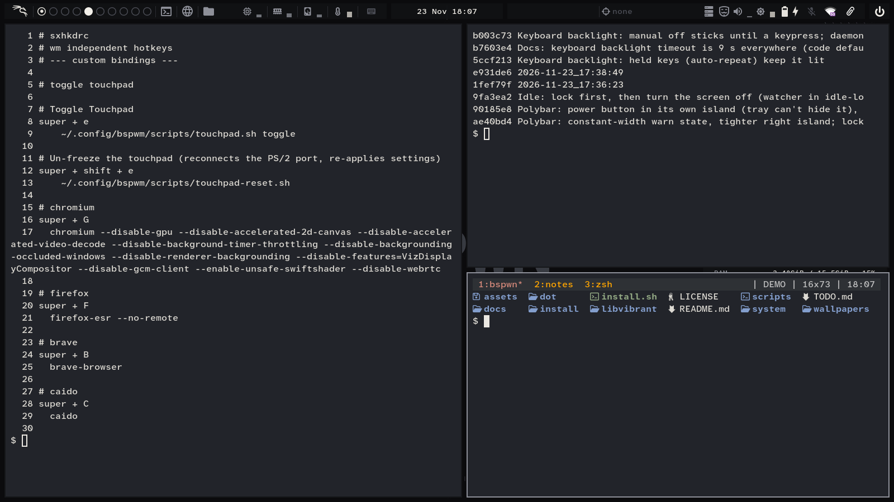

1. **Open windows.** The first window fills the screen. The second splits it in two, the third splits one of those, and so on. Gaps are 8 px. Each window has a thin frame (lighter on the focused window) with an 8 px inner gap inside it.
2. **Move around.** `Super+h/j/k/l` moves the focus left / down / up / right (like vim). `Super+Shift+h/j/k/l` swaps the window with its neighbour.
3. **Resize.** `Super+Alt+h/j/k/l` grows the window towards that side, `Super+Alt+Shift+h/j/k/l` shrinks it. Or drag with `Super+right-button`.
4. **Choose where the next window goes (preselect).** `Super+Ctrl+h/j/k/l` marks a side, `Super+Ctrl+3` sets the split ratio to 0.3, `Super+Ctrl+Space` cancels.
5. **Monocle.** `Super+m` shows one window full size and hides the rest; press again to go back. `Super+f` is real fullscreen.
6. **Floating.** `Super+s` lets a window float (free position, drag with `Super+left-button`); `Super+Shift+o` floats or tiles *everything*.
7. **Rotate.** `Super+Shift+r` turns the whole layout 90 degrees.
8. **Desktops.** `Super+1`..`9`,`0` switch desktop; add `Shift` to carry the focused window along. Use desktops to group work: 1 = main, 2 = browser, 3 = notes, and so on.

## Mouse

- `Super + left-drag` moves a window (it becomes floating while you do), `Super + right-drag` resizes it by the nearest corner.
- Focus follows the pointer only if you turn it on with `Super+p`.
- `Super+Tab` shows all windows as thumbnails (click one), `Alt+Tab` is a classic switcher: hold Alt, tap Tab, release.

## Launchers and apps

- `Super+r` opens a full-screen **rofi** launcher: type a few letters, `Enter` starts it, `Esc` closes. The Kali logo in the bar does the same.
- `Super+d` opens the classic **jgmenu** app menu.
- App shortcuts: terminal `Super+Return`, browsers `Super+Shift+b` (Brave), `Super+Shift+g` (Chromium), `Super+Shift+f` (Firefox).
- Bar buttons: terminal (left click = tmux session, right = plain), globe (Brave), folder (Thunar: left = home, right = Downloads).

## Screenshots

`Print` or `Super+Shift+s` opens flameshot to select a region. `Ctrl+Print` copies a region to the clipboard. `Super+Shift+w` saves the whole screen into `~/Pictures`.

## Power menu

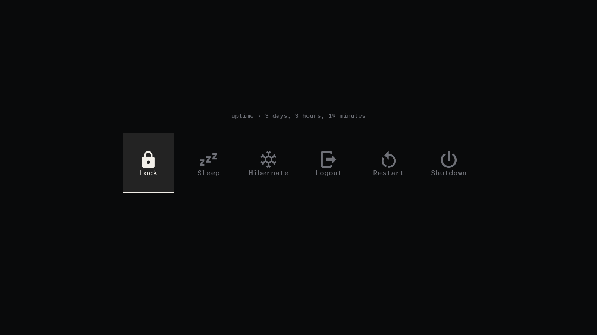

The power symbol (21) opens a full-screen menu: **Lock, Sleep, Hibernate, Logout, Restart, Shutdown**. `Esc` or a second click closes it.
*Hibernate* saves the session to disk and powers off; on the next boot you enter the disk passphrase and everything is back, so nothing is lost and no battery is used.
After a resume, the hook `/usr/lib/systemd/system-sleep/bspwn-cpufreq` (from `system/`) re-applies the CPU governor, because the CPU can otherwise stay at its lowest clock. If everything is slow after a resume, check `grep MHz /proc/cpuinfo` and `journalctl -t bspwn-cpufreq`.

# 5. Desktop shortcuts

Keys are read by **sxhkd** from `dot/.config/sxhkd/sxhkdrc`. **Super** is the Windows key. In `sxhkdrc` a capital letter means *Shift + that letter*
(`super + B` is `Super+Shift+b`). Below is the full list; the picture shows the Super layer on a keyboard.

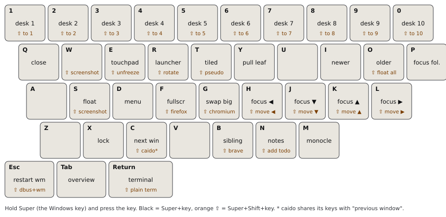

#### Apps and menus

| Keys | Action |
| --- | --- |
| `super+Return` | Terminal attached to the tmux session (created if missing) |
| `super+shift+Return` | Plain terminal, no tmux |
| `super+d` | App menu (jgmenu) |
| `super+r` | Full-screen launcher (rofi); press again to close |
| `super+shift+g` | Chromium |
| `super+shift+f` | Firefox |
| `super+shift+b` | Brave browser |
| `super+shift+c` | Caido |
| `super+n` | Desktop notes: edit |
| `super+shift+n` | Desktop notes: quick-add a todo |
| `super+ctrl+n` | Desktop notes: tick a task |
| `super+Tab` | Window overview (skippy-xd paging) |
| `alt+Tab` | Window switcher: hold Alt, Tab cycles, release to focus |
| `alt+shift+Tab` | Window switcher, backwards |

#### Desktop, power and system

| Keys | Action |
| --- | --- |
| `super+x` | Lock the screen |
| `super+ctrl+u` | Switch mode live: cockpit <-> undercover |
| `super+ctrl+e` | Spreadsheet key: undercover mode, minimise all windows, OnlyOffice sheet on top |
| `super+ctrl+s` | Server mode on/off (keep running with the lid closed) |
| `super+Escape` | Restart bspwm (re-reads bspwmrc, applies the mode) |
| `alt+shift+Escape` | Reload sxhkd (this file) |
| `super+alt+Escape` | Log out (quits bspwm, or xfwm4 in undercover) |
| `super+shift+Escape` | Restart the D-Bus daemon and bspwm (last resort) |
| `super+p` | Toggle focus-follows-pointer |
| `super+e` | Toggle touchpad |
| `super+shift+e` | Un-freeze a stuck touchpad |
| `Print` | Screenshot, region (flameshot) |
| `super+shift+s` | Screenshot, region (flameshot) |
| `ctrl+Print` | Screenshot, region copied to the clipboard |
| `super+shift+w` | Screenshot, whole screen saved to ~/Pictures |
| `XF86AudioRaiseVolume` | Volume up |
| `XF86AudioLowerVolume` | Volume down |
| `XF86AudioMute` | Mute |
| `XF86AudioMicMute` | Microphone mute |
| `XF86MonBrightnessUp` | Brightness +3% |
| `XF86MonBrightnessDown` | Brightness -3% |

#### Windows (bspwm)

| Keys | Action |
| --- | --- |
| `super+q` | Close the focused window |
| `super+m` | Toggle tiled / monocle layout (one window full size) |
| `super+t` | Tiled |
| `super+shift+t` | Pseudo-tiled |
| `super+f` | Fullscreen |
| `super+s` | Floating (toggle) |
| `super+shift+o` | Float / un-float all windows |
| `super+ctrl+x` | Lock the window against closing |
| `super+ctrl+y` | Sticky (follows you across desktops) |
| `super+ctrl+z` | Private |
| `super+g` | Swap with the biggest window |
| `super+y` | Send to the last manual window / pull the last leaf |
| `super+shift+r` | Rotate the whole layout 90 degrees |
| `super+h` | Focus window to the left |
| `super+j` | Focus window below |
| `super+k` | Focus window above |
| `super+l` | Focus window to the right |
| `super+shift+h` | Move window left (swap) |
| `super+shift+j` | Move window down (swap) |
| `super+shift+k` | Move window up (swap) |
| `super+shift+l` | Move window right (swap) |
| `super+b` | Focus the sibling (brother) node |
| `super+comma` | Focus the first child |
| `super+period` | Focus the second child |
| `super+c` | Focus next window on this desktop |
| `super+o` | Focus the older window in the focus history |
| `super+i` | Focus the newer window in the focus history |

#### Desktops

| Keys | Action |
| --- | --- |
| `super+1..9,0` | Go to desktop 1-9 and 10 (the 0 key) |
| `super+shift+1..9,0` | Send the window there and follow it |
| `super+Left` | Previous desktop |
| `super+Right` | Next desktop |
| `super+alt+Left` | Send window to the previous desktop |
| `super+alt+Right` | Send window to the next desktop |
| `super+bracketleft` | Previous desktop (same monitor) |
| `super+bracketright` | Next desktop (same monitor) |

#### Resize, preselect, mouse

| Keys | Action |
| --- | --- |
| `super+alt+h` | Grow the window to the left |
| `super+alt+j` | Grow it downwards |
| `super+alt+k` | Grow it upwards |
| `super+alt+l` | Grow it to the right |
| `super+alt+shift+h` | Shrink from the right |
| `super+alt+shift+j` | Shrink from the top |
| `super+alt+shift+k` | Shrink from the bottom |
| `super+alt+shift+l` | Shrink from the left |
| `super+shift+Left` | Move a floating window left |
| `super+shift+Down` | Move a floating window down |
| `super+shift+Up` | Move a floating window up |
| `super+shift+Right` | Move a floating window right |
| `super+ctrl+h` | Preselect: next window opens to the left |
| `super+ctrl+j` | Preselect: below |
| `super+ctrl+k` | Preselect: above |
| `super+ctrl+l` | Preselect: to the right |
| `super+ctrl+1..9` | Preselect the split ratio 0.1 .. 0.9 |
| `super+ctrl+space` | Cancel the preselection of this window |
| `super+ctrl+shift+space` | Cancel all preselections on this desktop |
| `super+left-drag` | Move a window with the mouse |
| `super+right-drag` | Resize a window by the nearest corner |

## Notes on the key list

- The browser shortcuts use capital letters in `sxhkdrc`, so they really are `Super+Shift+g/f/b`, and Caido is `Super+Shift+c`.
- Every combination is bound exactly once; `python3 scripts/docs/build.py --check` also reports a shortcut that is documented here but not bound, or the reverse.
- `Super+Shift+Escape` restarts the D-Bus daemon: it is a last resort, and can close apps that depend on the session bus.
- Before adding a shortcut, search the file for the combination (`grep -n "super + p" ~/.config/sxhkd/sxhkdrc`); if two lines use the same combination, only one of them will fire.

# 6. tmux

tmux keeps terminals alive: windows and panes live inside a *server* that keeps running when you close the terminal window. `Super+Return` always attaches to session `0`
(creating it if needed), so you come back to exactly where you left.

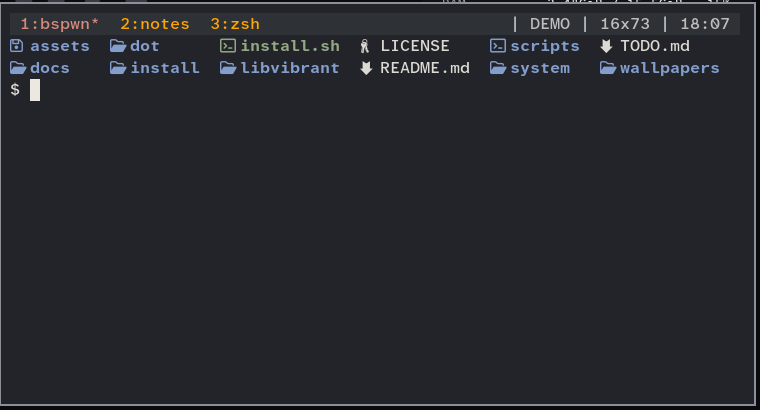

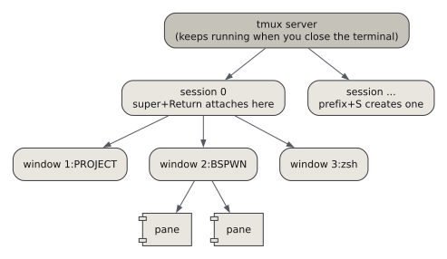

- **Two ways to press keys.** Most useful commands work with just **Alt** (no prefix). The classic way is the **prefix `Ctrl+b`**, release, then a key. Both are listed below.
- The status bar is at the **top**. Windows are numbered from 1. The session name is on the left and the clock on the right, both on a slightly lighter block (`#434649`, the bar colour 10% brighter); the pane size and the current window use a shade 2% darker (`#3e4144`). The current window is shown as a block: the `#3e4144` shade with `#c5c5c5` text in a terminal with true colour, reverse video on a text console (tty, 8 colours), where the shades cannot be drawn. tmux picks this per attached terminal. A window with new output or a bell gets a `+` after its name, a zoomed pane a `Z`; these plain characters read the same in a GUI and on a tty. True colour is only enabled for GUI terminals, so a tty gets the 8 basic colours instead of codes it cannot show. The blocks are padded with spaces and touch each other, with no gaps or `|` separators.
- Copy mode uses **vim keys**; selecting with the mouse copies to the system clipboard (`xclip`) when you release. Mouse mode is **on by default** (`Alt+m` toggles it; hold Shift to select text natively).
- Reload the config with `Alt+r` after editing `~/.tmux.conf`.

#### Without the prefix (Alt)

| Keys | Action |
| --- | --- |
| `alt+t` | New window (same folder) |
| `alt+1..9` | Go to window 1-9 |
| `alt+Left` | Previous window |
| `alt+Right` | Next window |
| `alt+{` | Move the window left in the list |
| `alt+}` | Move the window right in the list |
| `alt+e` | Rename the window |
| `alt+q` | Kill the window (asks first) |
| `alt+|` | Split side by side |
| `alt+-` | Split top / bottom |
| `alt+h` | Pane left |
| `alt+j` | Pane down |
| `alt+k` | Pane up |
| `alt+l` | Pane right |
| `alt+shift+h` | Resize pane left (5) |
| `alt+shift+j` | Resize pane down |
| `alt+shift+k` | Resize pane up |
| `alt+shift+l` | Resize pane right |
| `alt+,` | Swap pane up |
| `alt+.` | Swap pane down |
| `alt+z` | Zoom / unzoom the pane |
| `alt+o` | Zoom / unzoom the pane |
| `alt+x` | Kill the pane (asks first) |
| `alt+w` | Kill the pane (asks first) |
| `alt+shift+w` | Kill the pane, no question |
| `alt+space` | Next pane layout |
| `alt+v` | Scroll / copy mode |
| `alt+m` | Mouse mode on/off (on by default) |
| `alt+r` | Reload ~/.tmux.conf |

#### After the prefix (Ctrl+b, then the key)

| Keys | Action |
| --- | --- |
| `Ctrl+b, t` | New window |
| `Ctrl+b, w` | Pick a window from a tree (and kill with the confirm prompt) |
| `Ctrl+b, s` | Pick a session from a tree |
| `Ctrl+b, S` | New session (asks for a name) |
| `Ctrl+b, d` | Detach (the session keeps running) |
| `Ctrl+b, |` | Split side by side |
| `Ctrl+b, -` | Split top / bottom |
| `Ctrl+b, b` | Break the pane out into its own window |
| `Ctrl+b, Escape` | Scroll / copy mode |
| `Ctrl+b, p` | Paste buffer |
| `Ctrl+b, P` | Choose a paste buffer |
| `Ctrl+b, r` | Reload ~/.tmux.conf |
| `Ctrl+b, T` | Clock |
| `Ctrl+b, Ctrl+l` | Clear screen and history |
| `Ctrl+b, Ctrl+s` | Show / hide the status bar |
| `Ctrl+b, Ctrl+b` | Send Ctrl+b to the program inside |

#### Scroll / copy mode (vim keys)

| Keys | Action |
| --- | --- |
| `v` | Start selecting |
| `y` | Copy to the clipboard (stay in copy mode) |
| `Y` | Copy and leave |
| `r` | Rectangle selection |
| `/` | Search forward |
| `?` | Search backward |
| `b / w / e` | Word back / forward / end |
| `q` | Leave copy mode |

### Prompts (rename, search)

`Alt+e` and the search keys open a one-line prompt in the status bar. It is drawn over the whole bar. Type, `Enter` to accept, `Esc` to cancel.

# 7. The shell (zsh)

`~/.zshrc` is deliberately tiny: it sources **`~/.zsh/init.zsh`**, which loads the modules in a fixed order (the order matters, so it is spelled out in that file):

| Folder / file | What is in it |
| --- | --- |
| `config/` | shell options (`main.zsh`), history, completion (zsh-autocomplete permanently disabled; lists appear only on Tab), key bindings, the X display fix |
| `prompt/` | the prompt, IP detection (`get_ipaddr`), cursor style |
| `plugins/` | fzf (`Ctrl+F` file finder; its `Ctrl+R` history list is disabled, `Ctrl+R` is zsh's inline history search), autosuggestions (grey history hint; Right arrow or End accepts it), syntax highlighting (sourced once, with palette-friendly styles) |
| `aliases/` | aliases such as `ls` = `lsd`, `cat` = `batcat` |
| `functions/` | helpers: the `setg` / `unsetg` lab variables, apt wrappers, small tools |
| `pentest/` | optional lab helpers; a failure here never stops the shell |
| `exports.zsh`, `theme.zsh` | `PATH` (every entry once) and environment; ls/less colours |
| `~/.zshrc.local` | **your machine-specific extras, not in git** (loaded last, optional) |

Add your own aliases to `dot/.zsh/aliases/aliases.zsh`, a new function to a file in `functions/`, a new plugin as `plugins/<name>.zsh` (it is picked up automatically).
Machine-specific things (a language manager's PATH line, a GPU variable) belong in `~/.zshrc.local`. The polybar LHOST/RHOST widgets rewrite the `lhost` / `rhost` lines of `~/.zshrc`, so leave those lines in that file.

| Keys | Action |
| --- | --- |
| `Ctrl+F` | Fuzzy-find any file and paste its path (exact, case-insensitive; 'word' quotes whole words) |
| `Tab / Shift+Tab` | Cycle the completion menu forward / back |
| `Left / Right` | Move the text cursor; Right (or End) at the end of the line accepts the grey suggestion |
| `Ctrl+R` | Search the history backward, inline (zsh's own search; Ctrl+R again for older matches) |
| `Ctrl+Left / Right` | Jump a word |
| `Ctrl+Delete` | Delete the next word |
| `PageUp / PageDown` | Start / end of history |

- **Ctrl+F** is the most useful key: type a few letters of any file name from anywhere and press Enter to paste the full path. Quote a word (`'name'`) to match it as a whole word.
- Completion appears only when you press Tab (the as-you-type menu of zsh-autocomplete is disabled); Tab and Shift+Tab cycle through the menu.
- The prompt can show your LHOST address; the bar's LHOST/RHOST widgets set the same variables (`rhost` is written into `~/.zshrc`).

# 8. Modes: cockpit and undercover

`Super+Ctrl+u` (or the mask in the bar) switches the **whole desktop live**, no logout:

| | cockpit (default) | undercover |
| --- | --- | --- |
| look | monochrome rice | a Windows 10 look |
| panel | polybar + conky HUD | tint2 |
| windows | tiling (bspwm) | floating with Windows-10 frames (xfwm4) |

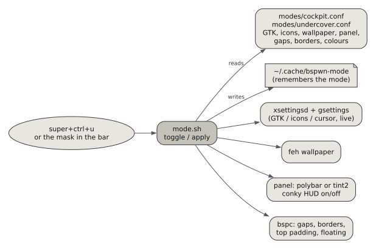

Each mode is a profile: `dot/.config/bspwm/modes/<mode>.conf` (theme names, icon theme, cursor, font, wallpaper, panel, gaps, border width and colours, `CONKY=1/0`, `FLOATING=1/0`).
`scripts/mode.sh` reads it and applies it; the active mode is remembered in `~/.cache/bspwn-mode`.
**Important:** `mode.sh apply` rewrites the GTK settings from the profile on every start, so a look change must also go into the active profile or it will be undone on the next apply (themer does this for you).

> **Cockpit settings, all in one file: `dot/.config/bspwm/modes/cockpit.conf`**
>
> Change a value, then apply it with `~/.config/bspwm/scripts/mode.sh apply` (or `Super+Esc`). It stays across reloads and logins.
>
> | Setting | What it does |
> | --- | --- |
> | `CONKY=1` / `CONKY=0` | conky HUD on / off (on battery it is always off) |
> | `PANEL` | `polybar` or `tint2` |
> | `FLOATING` | `1` = new windows float, `0` = tiling |
> | `GAP` | space between windows, in px |
> | `BORDER`, `DOUBLE_BORDER`, `BORDER_GAP_COLOR` | window frame: `BORDER=9` with `DOUBLE_BORDER=1` = 1 px line + 8 px inner gap |
> | `FOCUSED_COLOR`, `ACTIVE_COLOR`, `NORMAL_COLOR` | frame line colours (focused / other windows) |
> | `GTK_THEME_NAME`, `ICON_THEME`, `CURSOR_THEME`, `UI_FONT`, `COLOR_SCHEME` | look of the apps (`themer` writes these) |
> | `WALLPAPER` | background image |
> | `TOP_PAD`, `BOTTOM_PAD` | room kept free for the bar |
> | `PICOM_CONF` | picom config, used only when `PICOM=1` in `power.conf` |
>
> Power, battery and compositor on/off are in `dot/.config/bspwm/power.conf`. Undercover mode has the same keys in `modes/undercover.conf`.


**Window frames in undercover.** bspwm draws no title bars, so with `WM=xfwm4` in the profile undercover runs **xfwm4** (Windows-10 theme: title bar, minimise, maximise, close, drag to move, snap to the edges). This needs the session launcher `scripts/session.sh`, started by the **bspwn** login session (`system/etc/lightdm/xsessions/bspwn.desktop` -> `/usr/local/bin/bspwn-session`, from `system/bin`). Switching mode restarts the window manager and keeps every window open: going to undercover, the windows of all bspwm desktops are gathered on one xfwm4 workspace; going back, bspwm puts each one on its old desktop. xfwm4 reads its own settings (`dot/.config/bspwm/xfwm4/xfwm4.xml`, copied into a private xfconf in `~/.cache/bspwn/xfwm4`), so XFCE's settings are not changed. Under xfwm4 the bspwm window keys (`super+h/j/k/l`, desktops, ...) do nothing; app and system keys still work, and `alt+F4`, `alt+Tab` are xfwm4's. Logging in with the plain **bspwm** session keeps bspwm in undercover too (floating windows without frames, `FLOATING=1`). Log: `journalctl -t bspwn-session`.

**Spreadsheet key** (`Super+Ctrl+e`, `scripts/boss.sh`): switches to undercover, minimises every window to the taskbar and puts an OnlyOffice spreadsheet (a new one, or the one already open) maximised on top. Log: `journalctl -t bspwn-boss`.

To make a new mode: copy `cockpit.conf` to `modes/mymode.conf` and edit the values. `mode.sh` only knows the names `cockpit` and `undercover` today, so add your name to its two `case` lines (the `toggle` branch and the `cockpit|undercover)` branch) to be able to switch to it.

# 9. Themes, colours and wallpaper

## themer

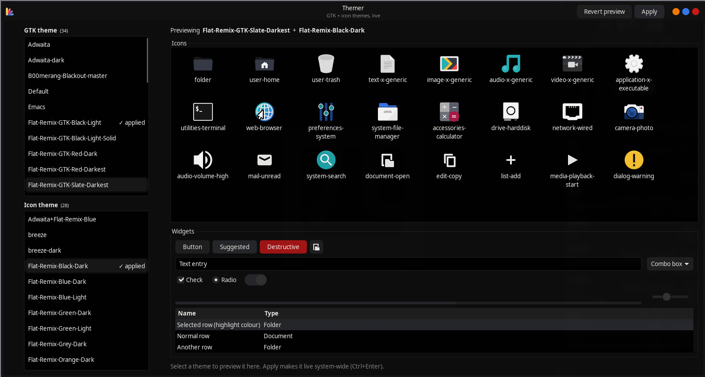

`themer` lists every installed GTK and icon theme, restyles its own window as you click, and **Apply** (`Ctrl+Enter`) makes it live everywhere.
Headless: `themer --gtk NAME --icons NAME`, `themer --list`, `themer --current`.

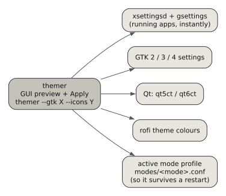

## Terminal palette

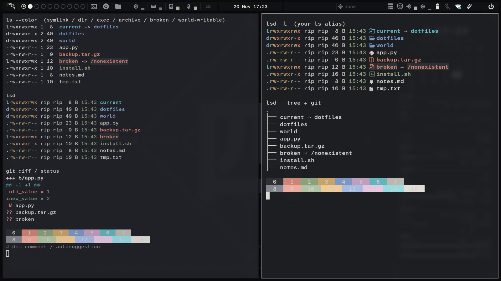

The palette lives in two files that must be edited together: `dot/.config/kitty/cockpit.conf` and the `[colors]` block of `dot/.config/alacritty/alacritty.toml`
(alacritty reloads by itself; kitty needs `Ctrl+Shift+F5`). Every pair of hues differs in lightness
as well as hue. After changing a colour run:

```sh
python3 scripts/palette_check.py     # exit code 1 means a target was missed
```

**Cursor:** a steady bar in the shell (reset before every prompt by `dot/.zsh/prompt/cursor.zsh`, `BSPWN_CURSOR=2` for a block), a block in vim/nvim normal mode and a bar in insert mode. Programs switch it with DECSCUSR (`\e[N q`); tmux passes it through (`Ss`/`Se` in `dot/.tmux.conf`). Default shape: `[cursor.style]` in `alacritty.toml`, `cursor_shape` in `kitty.conf`.

## Other colours

| What | File |
| --- | --- |
| bar colours | `[colors]` at the top of `dot/.config/polybar/config.ini` |
| HUD | `dot/.config/conky/hud.lua` (palette) and `hud.conf` |
| launcher | `dot/.config/rofi/colors/cockpit.rasi` |
| notifications | `dot/.config/dunst/dunstrc` |
| window borders | `FOCUSED_COLOR`, `ACTIVE_COLOR`, `NORMAL_COLOR` in the mode profile; inner gap colour `BORDER_GAP_COLOR` |
| tmux status bar | `status-style` and friends in `dot/.tmux.conf` |

## Wallpaper

Wallpapers are generated with Pillow by `scripts/wallpaper/gen_*.py` into `assets/wallpaper/*.jpg`. The active one is `WALLPAPER=` in the mode profile
(and the `feh` line in `bspwm/start`). Keep the art clear of the HUD column on the right (the screen is 1600x900).

**Personal wallpaper:** `./install.sh -wallpaper` (also in `-full`) runs `gen_bspwn.py --user` and saves your user name in capitals to `~/.local/share/bspwn/wallpaper.jpg`, used when it exists (else `assets/wallpaper/bspwn.jpg`). Delete it to go back to BSPWN; `--text WORD` makes any other word.

# 10. Lock screen and idle

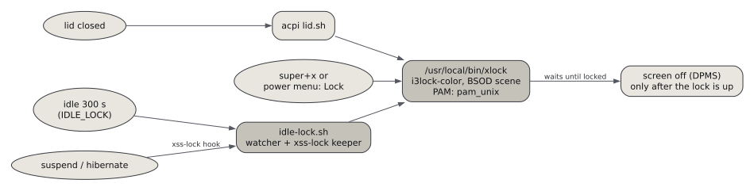

- `Super+x` (or the power menu) locks the screen. It also locks by itself after **300 seconds** idle, when the lid closes, and **before suspend**.
- **Lock first, then screen off:** the display is only turned off once the lock is really on screen, so waking it shows the lock and never the desktop.
- The lock screen is a full-screen blue "crash" scene. Type your password and press Enter to unlock; it uses PAM (`/etc/pam.d/i3lock`).
- `scripts/idle-lock.sh` supervises the idle timer and keeps `xss-lock` alive. Log: `journalctl -t idle-lock`; the locker logs to `journalctl -t xlock`.
- **Never run `xlock` just to test it**: it really locks the session. Test by reading the logs and screenshots instead.

# 11. Power tools

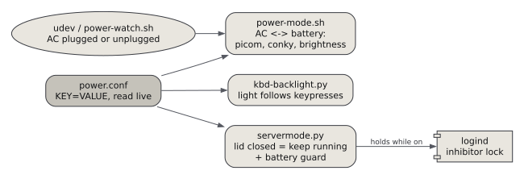

All settings are in **`~/.config/bspwm/power.conf`**, a plain `KEY=VALUE` file that is read live: save it and the change applies within seconds.

| Tool | What it does | Main settings |
| --- | --- | --- |
| **compositor** | picom (off by default; with `PICOM=1` it runs only on AC): a 0.2 s fade when windows appear or disappear, no transparency, shadows or blur | `PICOM=0/1` |
| **keyboard backlight** | lights at the first keypress or pointer movement (touchpad, TrackPoint, any mouse), off after the last input (held keys count) | `KBD_IDLE_AC`, `KBD_IDLE_BAT`, `KBD_LEVEL`, `KBD_AUTO`, `KBD_WAKE_POINTER` |
| **server mode** | closing the lid does not suspend: the laptop keeps running (ssh, downloads) with the screen locked and dark. Button 14 or `Super+Ctrl+s` | `SERVER_BATTERY_MIN`, `SERVER_BATTERY`, `SERVER_LOCK`, `SERVER_SCREEN_OFF` |
| **battery guard** | warns at 15%, counts down and hibernates at 7%, never suspends below 30%, and also watches battery voltage | `GUARD_*` |

The full table of every setting, with the reasons behind them, is in the repository README under "Power tools". Handy commands:
`~/.config/bspwm/scripts/servermode.py status`, `journalctl -t bspwn-power`, `python3 scripts/tests/test_power.py` (tests on a fake battery, touches no hardware),
and `~/.config/bspwm/scripts/power-mode.sh auto --force` to re-apply after editing `power.conf`.

# 12. Changing things

## The safe way to change anything

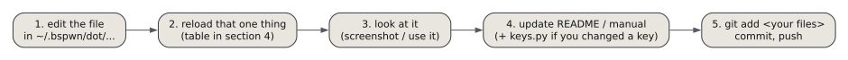

1. **Edit** the file under `~/.bspwn/dot/...` (or `~/.config/...`, the same file).
2. **Reload only that piece** with the table below. You rarely need to log out.
3. **Look at it.** A screenshot (`import -window root /tmp/s.png`) is a good way to review a change.
4. **If it broke, undo with git:** `git -C ~/.bspwn diff` shows what you changed and `git -C ~/.bspwn checkout -- path/to/file` restores one file.
5. **Document and save:** if you changed a shortcut, edit `scripts/docs/keys.py` and run `python3 scripts/docs/build.py`; then `git add` your files, `commit`, `push`.

## Where do I change X, and how do I reload it?

| I want to change... | Edit | Reload with |
| --- | --- | --- |
| a keyboard shortcut | `dot/.config/sxhkd/sxhkdrc` | `Alt+Shift+Esc` (or `pkill -USR1 -x sxhkd`) |
| gaps, borders, window rules, number of desktops | `dot/.config/bspwm/bspwmrc` and the active `modes/*.conf` | `Super+Esc` (restart bspwm) |
| the apps that start with the session | `process_list` in `dot/.config/bspwm/start` | `Super+Esc` |
| the bar: modules, buttons, colours | `dot/.config/polybar/config.ini` | `~/.config/polybar/launch.sh` |
| the HUD | `dot/.config/conky/hud.conf`, `hud.lua` | `pkill conky; conky -q -c ~/.config/conky/hud.conf &` |
| GTK / icon theme | run `themer` | automatic |
| terminal colours or font | `kitty/cockpit.conf`, `alacritty/alacritty.toml` | alacritty: automatic; kitty: `Ctrl+Shift+F5` |
| tmux keys and bar | `dot/.tmux.conf` | `Alt+r` inside tmux |
| shell aliases / functions | `dot/.zsh/...` | `source ~/.zshrc` or open a new terminal |
| notifications | `dot/.config/dunst/dunstrc` | `pkill dunst; dunst &` |
| launcher look | `dot/.config/rofi/*.rasi` | next time you open it |
| wallpaper | `WALLPAPER=` in `modes/*.conf` | `~/.config/bspwm/scripts/mode.sh apply` |
| idle time, keyboard light, server mode, battery guard | `dot/.config/bspwm/power.conf` | automatic (read live); `power-mode.sh auto --force` for the compositor |
| the whole look / mode | `dot/.config/bspwm/modes/*.conf` | `mode.sh apply` |

## Recipes

### Add or change a keyboard shortcut

Open `dot/.config/sxhkd/sxhkdrc`. A shortcut is a key line followed by an *indented* command line:

```
# open the music player
super + shift + m
    alacritty -e ncmpcpp
```

Rules of the format: keys are joined with ` + `; **a capital letter means Shift**; `{a,b}` expands into several shortcuts (`super + {h,j,k,l}` makes four);
`{1-9}` is a range. Pick a free combination (search the file first), save, press `Alt+Shift+Esc`. Then add the line to `scripts/docs/keys.py` so the docs know it
(`python3 scripts/docs/build.py --check` reports anything you forgot).

### Change the browser (shortcut and bar button)

- Shortcut: edit the command under `super + B` in `sxhkdrc`.
- Bar button: in `config.ini`, module `[module/app-brave]`: `click-left = brave-browser &` is the command, `format = ...` is the icon.
- **Icons are real characters**, not escape codes. Write them with Python so the glyph survives:
  `python3 -c "print(chr(0xf059f))"` prints the globe. Search icon codes at nerdfonts.com/cheat-sheet; the bar uses the *Symbols Nerd Font Mono* font.

### Add a button or a stat to the bar

1. Copy an existing `[module/app-...]` block in `config.ini`, rename it, change `format` (icon) and `click-left` (command).
2. Add its name to the right `modules-left` / `modules-center` / `modules-right` line of the island you want.
3. `~/.config/polybar/launch.sh`. A script-driven stat uses `type = custom/script` with `exec = your-script` and `interval = 5`.

### Start a program with the session

Add its command to `process_list` in `dot/.config/bspwm/start` (it will be restarted each time the session starts) and run `Super+Esc`.

### Make a program always float, or open on a desktop

In `bspwmrc`, next to the other rules: `bspc rule -a "Burp Suite Community Edition" state=floating`, or `bspc rule -a firefox desktop='^2'`.
Find a window's class with `xprop WM_CLASS` and click the window.

### Change gaps and borders

`GAP=` and `BORDER=` in `modes/cockpit.conf` (plus `TOP_PAD=` so windows do not hide under the bar); the colours are in the same file. Apply with `mode.sh apply`.

**Double border (line + inner gap).** With `DOUBLE_BORDER=1` the border is split in two bands: a 1 px line in the border colour and, inside it, `BORDER - 1` px in `BORDER_GAP_COLOR` (the terminal background), which reads as padding around every window. Cockpit uses `BORDER=9`: 1 px line + 8 px gap. bspwm itself can only paint one colour, so `scripts/double-border.py` (started by `mode.sh`, needs `python3-xlib`) sets a two-band border pixmap after each bspwm event. It costs no CPU while idle: it waits on `bspc subscribe`, reads the windows from `_NET_CLIENT_LIST` instead of running `bspc`, repaints at once on the first event and once more after a burst (30 ms quiet). bspwm's own border colours are set to the gap colour, so switching windows never flashes a bright band. For a plain border set `DOUBLE_BORDER=0` and `BORDER=1`.

### Change the bar height

The bar is 20 px high and sits 6 px below the top edge, so it uses the top 26 px. Everything placed under it follows those two numbers; change them together:

| File | Setting | Now |
| --- | --- | --- |
| `polybar/config.ini` | `[bar/base]` `height`, `offset-y`; font sizes and `;N` vertical offsets so icons fit | `20`, `6` |
| `polybar/config.ini` | `[bar/tray]` `offset-y` (tray drawer, 6 px under the bar) | `32` |
| `bspwm/modes/cockpit.conf` | `TOP_PAD` = offset + height | `26` |
| `rofi/launch.rasi` | `bar-height`, `bar-top` (launcher drawn over the bar) | `20px`, `6px` |
| `rofi/inline.rasi`, `rofi/shared/pentest-input.rasi` | `y-offset` (just under the bar) | `30px`, `28px` |
| `polybar/scripts/calendar-popup.py` | `BAR_BOTTOM` | `26` |
| `jgmenu/jgmenurc` | `menu_margin_y` | `26` |
| `dunst/dunstrc` | `offset` (y) | `(16, 40)` |
| `conky/hud.conf` | `gap_y` and `minimum_height`/`maximum_height` (top moves, bottom stays at 868) | `54`, `814` |

Apply with `mode.sh apply` (bar and padding), then restart conky and dunst. The wallpaper does not depend on the bar: its frame keeps a 40 px margin on every side.

### Change the lock or idle time

`IDLE_LOCK=${IDLE_LOCK:-300}` near the top of `dot/.config/bspwm/scripts/idle-lock.sh` (seconds of inactivity). Restart the session (`Super+Esc`) to apply it.

### Change a tmux key

Edit `dot/.tmux.conf`: `bind-key -n M-t new-window` means *Alt+t without prefix*, `bind t ...` means *prefix, then t*. `Alt+r` reloads it.
Keep `scripts/docs/keys.py` in sync.

### Add a shell alias

`dot/.zsh/aliases/aliases.zsh`: `alias gs='git status'`, then `source ~/.zshrc`.

### Add a whole new mode

See chapter 8: copy a profile, change the values, and teach `mode.sh` the new name.

## Rules of thumb

- Change **one thing at a time** and look at it.
- Keep your edits in `~/.bspwn` (that is where git is). Do not edit generated files such as `~/.config/xsettingsd/xsettingsd.conf`; they are rewritten from the mode profile.
- System files (`/etc/...`) need `sudo` and a backup (`.bak`) first; the repo has them under `system/` and `./install.sh -system` installs them.
- Public repo? Before you push, check the diff for secrets: IP addresses, Wi-Fi names, host names, tokens, and screenshots of the bar (it shows your IP).

# 13. Working with Claude Code

The repository includes a `CLAUDE.md` file at its root. [Claude Code](https://claude.com/claude-code) reads it automatically when you start it inside the repo, and it tells Claude how this
environment is organised, which files to edit, how to reload each part, what not to touch, and how to document and commit changes. In practice:

```sh
cd ~/.bspwn
claude
> change the browser button in the bar to Firefox, with its icon
> add a shortcut super+shift+m that opens the music player
> my battery is called BAT0 only, adapt the power settings
```

Claude will inspect first, show you a plan, change only what is needed, reload that piece, and ask before touching system files, the lock screen, or running the full installer.
For adapting the setup to a different laptop there is also a dedicated skill, `.claude/skills/adapt-bspwn`.

# 14. Troubleshooting

| Problem | Try |
| --- | --- |
| A shortcut does nothing | Is sxhkd running? `pgrep -x sxhkd`. Reload: `Alt+Shift+Esc`. Run the command from the shortcut by hand to see its error. |
| The bar is missing or wrong | `~/.config/polybar/launch.sh`; run `polybar -r left -c ~/.config/polybar/config.ini` in a terminal to see config errors. |
| An icon shows as a box or text like `\u{...}` | Polybar does not understand escapes: put the real glyph character in the file (see the browser recipe). |
| The look reverts after a restart | The mode profile still has the old values: edit `modes/<mode>.conf`, or use `themer`. |
| The HUD is gone | You are on battery (it is stopped on purpose), or run the conky command from chapter 12. |
| Black screen right after logging in, only Fn keys work | ly hung after starting Xorg. `ly-watchdog` returns to the login prompt within about 40 s (`journalctl -t ly-watchdog`). By hand: `Ctrl+Alt+F1`, log in, `sudo systemctl restart ly@tty2`, then `Ctrl+Alt+F2`. |
| The screen is solid blue | It is locked: type your password. Do not kill the locker from a terminal. |
| Nothing responds in a tmux prompt | Press `Esc`. The prompt owns the keyboard until you accept or cancel. |
| The touchpad is frozen | `Super+Shift+e` reconnects it; `Super+e` toggles it. |
| Server mode does not hold | `servermode.py status`, `systemd-inhibit --list | grep bspwn`, `journalctl -t bspwn-power`. |
| CPU is high after days of uptime | `ps -eo pid,ppid,etime,args | grep -E 'polybar/scripts|servermode.py bar'` lists leftover bar helpers; `~/.config/bspwm/scripts/polybar-reap.sh orphans` stops them (it also runs every 60 s). |
| I want to see the log of something | `journalctl -t <tag>` with `idle-lock`, `xlock`, `bspwn-power`, `bspwn-reap`, `bspwn-session`, `ly-watchdog`. |
| I broke a config | `git -C ~/.bspwn diff` to see it, `git -C ~/.bspwn checkout -- <file>` to restore it. |

# 15. Licence, credits and reuse

The code and configuration are released under the **GNU General Public License, version 2** (see `LICENSE`). Copyright (c) 2025-2026 **rippsec and contributors**; the
`NOTICE` file lists the people and the third-party components (themes, icons, fonts) that keep their own licences.
This manual and its diagrams are licensed **CC BY-SA 4.0**: you may share and adapt them if you credit the project and keep the same licence.

In plain words: you are free to use, change and redistribute this setup, including your own variations, **as long as you keep the copyright notice and the licence
and publish your changes under the same licence**. You may not remove the authorship, relicense it as closed source, or present the project as your own work.
The public git history (commit dates and authors) is the record of who made what. The author's only official channels are [GitHub](https://github.com/rippsec), [LinkedIn](https://www.linkedin.com/in/rippsec) and [Hack The Box](https://profile.hackthebox.com/profile/019c8c0d-954d-73ef-a0ea-f6291b8da8a4); anyone else claiming to be the author or to speak for the project is not official.

# Appendix A. File map

```
~/.bspwn/
  CLAUDE.md                        instructions for Claude Code (read automatically)
  README.md                        project front page + the full power.conf reference
  dot/.config/<app>/               configs, linked into ~/.config
    bspwm/   bspwmrc  start  power.conf  modes/*.conf  scripts/
    sxhkd/   sxhkdrc  scripts/
    polybar/ config.ini  launch.sh  scripts/
    conky/   hud.conf  hud.lua
  dot/.zsh/  dot/.tmux.conf        shell and tmux
  dot/theme/                       bundled GTK theme and icons
  scripts/   themer/  palette_check.py  wallpaper/  tests/  docs/
  system/                          root files (acpi, ly, X11, tlp, lock screen)
  install.sh  install/             installer
  docs/                            this manual, the cheatsheet, interactive.html, screenshots, diagrams
  .claude/skills/adapt-bspwn/      Claude Code skill for porting to other hardware
```

# Appendix B. Rebuilding this documentation

The manual, cheatsheet and interactive page are generated:

```sh
python3 scripts/docs/build.py            # everything (needs python3-markdown, weasyprint, graphviz)
python3 scripts/docs/build.py --check    # only verify the shortcut list against sxhkdrc and tmux.conf
```

Text lives in `docs/src/manual.md`, shortcuts in `scripts/docs/keys.py`, diagrams in `docs/diagrams/*.dot`. Never edit the generated files in `docs/` by hand.
